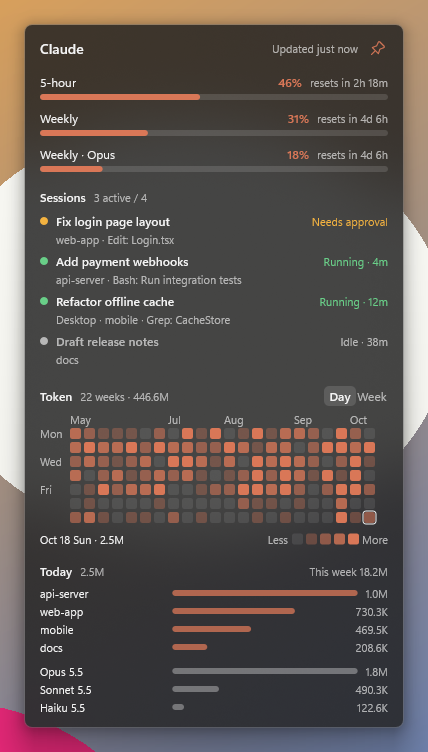
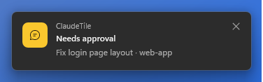
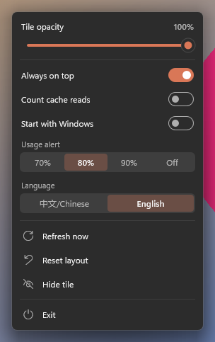

# ClaudeTile

English | [简体中文](README.zh-CN.md)

A desktop status tile for Claude on Windows: see what your Claude Code sessions are doing (CLI and the Claude desktop app), your 5-hour and weekly usage limits, and a GitHub-style heatmap of the tokens you use every day.

<p align="center">
  
</p>

- A single ~570 KB exe, about 13 MB of private memory, close to 0% CPU when idle.
- Follows the system light / dark theme; adjustable opacity, down to a see-through tile.
- English and Chinese interface.

> ClaudeTile is an unofficial community tool. It is not affiliated with or endorsed by Anthropic. "Claude" is a trademark of Anthropic.

## Install

Download `ClaudeTile-Setup-<version>.exe` from [Releases](https://github.com/ArthurLauCS/ClaudeTile/releases/latest) and run it. Requires 64-bit Windows 10 or 11; Windows 11 is recommended (rounded corners and shadows).

- The installer is not signed with a commercial code-signing certificate, so Windows may show "Windows protected your PC". Click **More info** → **Run anyway**.
- It installs for the current user only and does not ask for administrator permission.
- The language you pick in setup becomes the interface language. You can change it later from the menu.
- To see usage limits you need [Claude Code](https://docs.anthropic.com/en/docs/claude-code) signed in with a Claude subscription (Pro / Max). Sessions and token statistics work with any Claude Code login.

## What it shows

**Usage limits.** The 5-hour and weekly limits with a progress bar and a reset countdown, plus per-model weekly limits when your plan has them. From the last 30 minutes of usage it estimates when the 5-hour limit will run out ("At this pace, runs out in 1h 20m").

**Sessions.** Every running Claude Code session, from terminals and from the Claude desktop app: title, project, the tool it is running right now, and how long it has been in its current state. Sessions that need you (a permission prompt, a question) are listed first. Click a session to jump to its window.

**Token heatmap.** One cell per day, one column per week, like GitHub contributions. Switch to **Week** for a bar per week. Click a day or a week to see that period by project and by model. The number of weeks follows the tile width. Cache reads are not counted by default, since they are dozens of times larger than everything else; turn them on in the menu.

**Tray icon.** Shows the 5-hour usage percentage. Its color shows the state:

| Color | Meaning |
|---|---|
| Yellow | A session is waiting for you |
| Red | Something is wrong: login expired, usage API changed, or 5-hour usage at 90% or more |
| Green | A session is running |
| Terracotta | Idle |

**Notifications.** Cards in the lower-right corner when a session waits for you, when a limit reaches your alert level (70 / 80 / 90%, or off), or when the 5-hour limit will run out within 30 minutes. Click a card to jump to that session. They hold off while you are in a full-screen game or presenting.

<p align="center">
  
</p>

## Using the tile

- **Move:** drag the tile anywhere. It always stays fully on screen.
- **Width:** drag the left or right edge. The heatmap shows more weeks when wider.
- **Section heights:** drag the gap below the limits, sessions or token section. Each section scrolls with the mouse wheel when its content is taller. The sessions section shows 5 rows by default.
- **Always on top:** the pin in the upper-right corner. When unpinned, the tile stays on the desktop layer below other windows.
- **Menu:** right-click the tile or the tray icon. Opacity slider, always on top, counting cache reads, start with Windows, usage alert level, language, refresh, reset layout, hide the tile, exit. Switches and options keep the menu open, so you can change several at once; press Esc or click elsewhere to close it.
- **Show / hide:** left-click the tray icon.

<p align="center">
  
</p>

## Where the data comes from

ClaudeTile only reads what Claude Code already keeps on your computer, and never changes it.

| What | Source |
|---|---|
| Session state | `%USERPROFILE%\.claude\sessions\*.json`, written by Claude Code itself |
| Session titles, current tool, tokens | Conversation transcripts in `%USERPROFILE%\.claude\projects` |
| Desktop app session titles | `%APPDATA%\Claude\claude-code-sessions` |
| Usage limits | `https://api.anthropic.com/api/oauth/usage`, using the sign-in token Claude Code saved in `%USERPROFILE%\.claude\.credentials.json` |

- This is the only network request ClaudeTile makes, about every 2 minutes. There is no telemetry. It uses the proxy from your environment variables or from `env` in `~/.claude/settings.json`, the same one Claude Code uses.
- The usage endpoint is not a public API and may change. If it does, the tile and a notification tell you that ClaudeTile needs an update; sessions and token statistics keep working.
- ClaudeTile never refreshes the sign-in token itself. When it expires, open Claude Code once and it refreshes.
- Claude Code deletes transcripts older than 30 days by default, so ClaudeTile keeps its own daily totals. The heatmap keeps your history beyond 30 days.

ClaudeTile's own files are in `%APPDATA%\ClaudeTile`: `config.txt` (position, sizes, options) and `history.txt` (daily token totals). When uninstalling, you are asked whether to delete them; the default is to keep them.

## Build from source

Requires Rust (stable, edition 2024) on Windows.

```powershell
cargo build --release          # target\release\claudetile.exe
cargo test --release           # unit tests
```

- App icon: edit `assets/icon.svg` (40 px and up) or `assets/icon-small.svg` (16–32 px), then run `python scripts/icon.py`. Needs Chrome, Pillow and the Windows SDK (`rc.exe`). The generated `assets/app.res` is committed, so a normal build does not need the SDK.
- Installer: `powershell -NoProfile -ExecutionPolicy Bypass -File scripts/installer.ps1`. Needs [Inno Setup 6](https://jrsoftware.org/isinfo.php). Output: `target\installer\ClaudeTile-Setup-<version>.exe`.

Command-line options for testing:

| Option | Effect |
|---|---|
| `--claude-dir <dir>` | Read this directory instead of `~/.claude` |
| `--data <dir>` | Keep settings and history here instead of `%APPDATA%\ClaudeTile` |
| `--usage-file <file>` | Use this JSON instead of calling the usage endpoint |
| `--dump <file>` | Do not open a window; write what was read (sessions, daily tokens, limits) to a text file |
| `--top`, `--light`, `--dark`, `--lang zh\|en` | Force always on top, a theme or a language |

The scripts in `scripts/` capture the tile, menu and notification windows and send them clicks and scrolls without moving the real mouse.

## License

[MIT](LICENSE)
