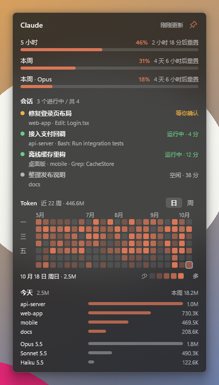
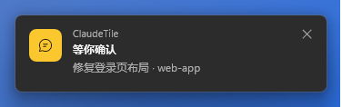
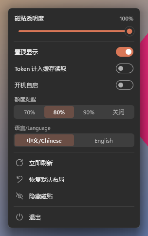

# ClaudeTile

[English](README.md) | 简体中文

Windows 上的 Claude 状态磁贴：看 Claude Code 各个会话在做什么（终端 CLI 和 Claude 桌面版都算）、5 小时和每周额度，还有一张像 GitHub 贡献图那样的每日 Token 热力图。

<p align="center">
  
</p>

- 单个约 720 KB 的 exe，私有内存约 13 MB，空闲时 CPU 接近 0%。
- 跟随系统深浅色；透明度可调，可以调到透出壁纸。
- 中英文界面。

> ClaudeTile 是非官方的社区工具，与 Anthropic 没有关联，也未获其认可。“Claude”是 Anthropic 的商标。

## 安装

从 [Releases](https://github.com/ArthurLauCS/ClaudeTile/releases/latest) 下载 `ClaudeTile-Setup-<版本>.exe` 运行。需要 64 位 Windows 10 或 11，推荐 Windows 11（有圆角和阴影）。

- 安装包没有商业代码签名证书，Windows 可能提示“Windows 已保护你的电脑”，点 **更多信息** → **仍要运行**。
- 只为当前用户安装，不要管理员权限。
- 安装时选的语言就是程序的界面语言，之后可以在菜单里改。
- 要看额度，需要 [Claude Code](https://docs.anthropic.com/zh-CN/docs/claude-code) 用 Claude 订阅（Pro / Max）登录。会话和 Token 统计任何 Claude Code 登录方式都能用。

## 显示什么

**账号详情。** 主界面按“同步 / 唤醒 → 账号 → 会话 → Token 热力图 / 今日项目消耗 → 重置信息”排列，分区用细线分隔。每个账号显示邮箱、订阅等级、5 小时及周额度百分比、进度条和重置时间；鼠标移上去卡片轻微高亮，当前账号底色更深；无法查询的字段明确留空，不显示为零。

**多账号。** 有几个 Claude 订阅时，菜单里点 **添加账号…** 会弹出命令行窗口，用 `claude auth login` 登录新账号。账号有两个以上时，额度栏下面列出每个账号的 5 小时额度条和每周百分比，点一下就把 Claude Code 切到那个账号（新开的会话用它，正在跑的会话要重开）。打开 **空闲时自动打卡**，哪个账号的 5 小时窗口没在跑，磁贴就用它发一条很小的 Haiku 消息（约 3k token），让窗口在你不在时就开始计时。

**重置信息。** 底部仅两行，显示 [codexreset.vercel.app](https://codexreset.vercel.app/zh) 的 Codex / Claude 状态，每 5 分钟刷新。只使用来源的“已重置 / 未重置 / 可能即将重置”状态，失败显示未知、来源超过 3 小时未更新显示信息较旧。点击行打开嵌入页面。查询公开接口不携带账号或 Token；这是社交媒体推断的额外重置信号，不代表你的个人额度已重置。

**会话。** 所有正在运行的 Claude Code 会话，终端里的和 Claude 桌面版里的都有：标题、项目、正在调用的工具、在当前状态里待了多久。等你处理的（要你确认权限、要你回答）排在最前。点一个会话就切到它所在的窗口。

**Token 热力图与今日项目消耗。** 热力图支持日 / 周切换，点击或悬停查看对应时段合计；下面独立列出今日各项目的消耗。两个区域各有 × 关闭按钮，可以在右键菜单分别重新打开，选择会保存。缓存读取默认不计，可用“缓存”开关切换。日期分组沿用 Windows 本地日期；额度重置、同步和唤醒时间按菜单里选的时区显示（默认北京时间，可选本机 / UTC）。

**托盘图标。** 数字是 5 小时额度的百分比，底色表示状态：

| 颜色 | 含义 |
|---|---|
| 黄 | 有会话在等你 |
| 红 | 有异常：登录过期、额度接口变了、5 小时额度用到 90% 以上 |
| 绿 | 有会话在运行 |
| 陶土色 | 空闲 |

**提示。** 右下角弹卡片：有会话等你、额度到了提醒线（70 / 80 / 90%，或关闭）、按当前速度半小时内会用完 5 小时额度。点卡片切到那个会话。全屏游戏或演示时先不弹。

<p align="center">
  
</p>

## 怎么用

- **移动：** 按住磁贴拖到任意位置，整块始终留在屏幕内。
- **宽度：** 拖左右边缘。越宽，热力图显示的周数越多。
- **各栏高度：** 拖额度、会话、Token 各栏下方的空隙。内容比栏高时用滚轮滚动。会话栏默认显示 5 行。
- **置顶：** 右上角的图钉。不置顶时磁贴和普通窗口一样：点击或拖动磁贴时它盖到其他窗口上面，点别的窗口后再被盖住。
- **菜单：** 右键磁贴或托盘图标。透明度滑块、置顶、空闲时自动打卡、开机自启、额度提醒、语言、时区、添加账号、立即刷新、恢复默认布局、隐藏磁贴、退出。点开关和选项时菜单不关，可以连着改；按 Esc 或点别处关闭。
- **显示 / 隐藏：** 左键点托盘图标。

<p align="center">
  
</p>

## 数据从哪来

ClaudeTile 只读 Claude Code 本来就存在电脑上的东西，从不改动。

| 内容 | 来源 |
|---|---|
| 会话状态 | `%USERPROFILE%\.claude\sessions\*.json`，Claude Code 自己写的 |
| 会话标题、当前工具、Token | `%USERPROFILE%\.claude\projects` 里的对话记录 |
| 桌面版会话标题 | `%APPDATA%\Claude\claude-code-sessions` |
| 额度 | `https://api.anthropic.com/api/oauth/usage`，用 Claude Code 存在 `%USERPROFILE%\.claude\.credentials.json` 里的登录凭证 |
| 其他账号 | `%APPDATA%\ClaudeTile\accounts\<账号>`，每个是那个账号登录时用的 `CLAUDE_CONFIG_DIR`。切换时把当前账号的 `.credentials.json` 和 `%USERPROFILE%\.claude.json` 里的 `oauthAccount` 存过去，再把选中账号的拷回来 |

- 这是 ClaudeTile 唯一的网络请求，约 2 分钟一次，没有任何统计上报。代理用环境变量或 `~/.claude/settings.json` 里 `env` 配的那个，和 Claude Code 一致。
- 额度接口不是公开 API，可能会变。变了的话，磁贴和提示会告诉你需要更新 ClaudeTile，会话和 Token 统计照常工作。
- ClaudeTile 不会自己刷新登录凭证。过期后打开一次 Claude Code 就会刷新。
- Claude Code 默认删除 30 天前的对话记录，所以 ClaudeTile 另存一份每日合计，热力图能保留 30 天以前的历史。

ClaudeTile 自己的文件在 `%APPDATA%\ClaudeTile`：`config.txt`（位置、尺寸、选项）和 `history.txt`（每日 Token 合计）。卸载时会问要不要删除它们，默认保留。

## 从源码构建

需要 Windows 上的 Rust（stable，edition 2024）。

```powershell
cargo build --release          # target\release\claudetile.exe
cargo test --release           # 单元测试
```

- 应用图标：改 `assets/icon.svg`（40px 及以上）或 `assets/icon-small.svg`（16～32px），再运行 `python scripts/icon.py`。需要 Chrome、Pillow 和 Windows SDK（`rc.exe`）。生成的 `assets/app.res` 已入库，平时编译不需要 SDK。
- 安装包：`powershell -NoProfile -ExecutionPolicy Bypass -File scripts/installer.ps1`，需要 [Inno Setup 6](https://jrsoftware.org/isinfo.php)。产物在 `target\installer\ClaudeTile-Setup-<版本>.exe`。

测试用的命令行参数：

| 参数 | 作用 |
|---|---|
| `--claude-dir <目录>` | 读这个目录，代替 `~/.claude` |
| `--data <目录>` | 设置和历史存这里，代替 `%APPDATA%\ClaudeTile` |
| `--usage-file <文件>` | 用这个 JSON 代替额度接口的返回 |
| `--dump <文件>` | 不开窗口，把读到的会话、每日 Token、额度写成文本 |
| `--top`、`--light`、`--dark`、`--lang zh\|en` | 强制置顶、主题或语言 |

`scripts/` 里的脚本可以截磁贴、菜单、提示窗口，并在不动真实鼠标的情况下给它们发点击和滚轮。

## 协议

[MIT](LICENSE)
